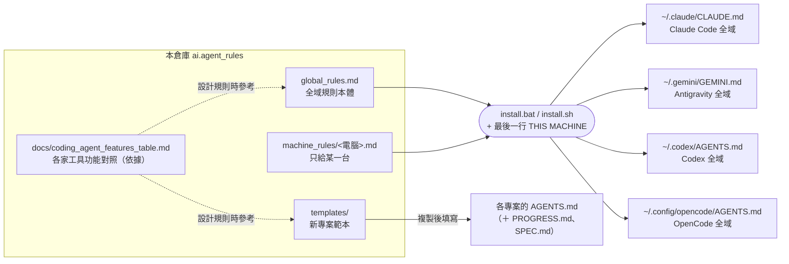
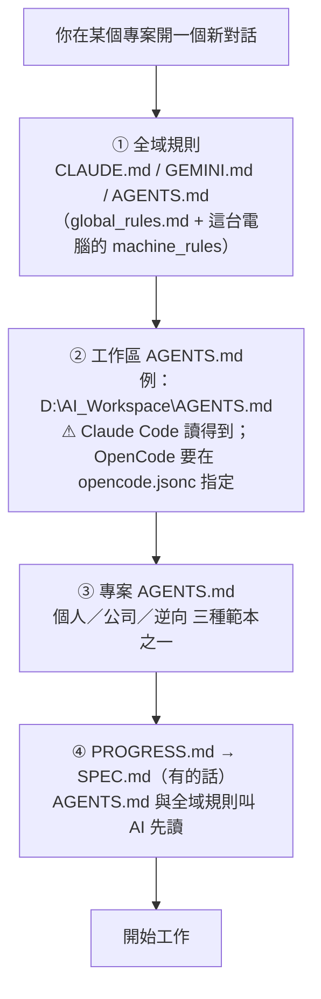
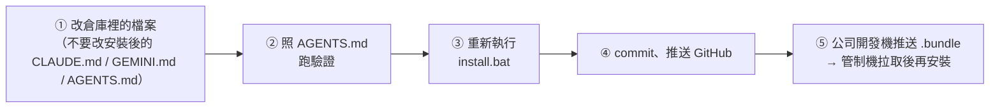
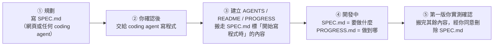

# ai.agent_rules

所有電腦共用的 **coding agent 規則**（目前用 Claude Code、Antigravity、Codex、OpenCode），放在 GitHub，方便每台電腦下載安裝。

> 第一次看：先讀「一、一張圖看懂」和「二、規則要寫在哪裡」就夠了，後面的章節需要時再查。

---

## 一、一張圖看懂

### 1. 規則從哪裡來、裝到哪裡



### 2. 一次對話，AI 會讀到哪些規則



- 越下層越優先：專案 `AGENTS.md` > 工作區 `AGENTS.md` > 全域規則。
- 全部都是**自動載入**，你不用每次貼規則；④ 是 AI 照 ③ 的指示自己去讀。

### 3. 每台電腦裝了什麼

| 電腦 | AI 工具 | ① 全域規則內容 | 專案同步 |
|---|---|---|---|
| 住家開發機（home） | Claude Code、Antigravity、Codex、OpenCode | `global_rules.md` | 只用 GitHub |
| 公司開發機（dev） | Claude Code、Antigravity、Codex、OpenCode | `global_rules.md` | GitHub、`.bundle`（兩邊的中繼） |
| 管制機（controlled） | Antigravity、OpenCode | `global_rules.md` + `machine_rules/controlled.md`（防毒、安裝、網路限制） | 只用 `.bundle`（連不到 GitHub） |

---

## 二、規則要寫在哪裡

新增一條規則前，照這張表由上往下找第一個符合的：

| 這條規則… | 寫在 | 範例 |
|---|---|---|
| 含公司內部資訊（主機、內網路徑、專案名稱） | 工作區 `AGENTS.md`（不進本倉庫） | 內網磁碟對應 |
| 管的是別人的 fork（不能改它的 `AGENTS.md`） | 工作區 `AGENTS.md` | fork 只讀、同步上游的做法 |
| 只適用某一台電腦 | `machine_rules/<電腦代號>.md` | 管制機的防毒限制 |
| 只有公司專案用得到 | `templates/AGENTS_company.md`「公司專案規則」區塊 | 發布、成品防毒相容 |
| 只有逆向分析專案用得到 | `templates/AGENTS_reverse.md`「逆向分析規則」區塊 | 原版備份、寫入長度檢查 |
| 只有一個專案用得到 | 該專案的 `AGENTS.md` | 某工具的業務規則 |
| 是查表、清單、操作步驟 | 本 README | 開發用 CLI 清單、AI 生圖規範 |
| **每次對話、每個專案都需要** | `global_rules.md`（200 行內） | 用繁體中文、`.venv` |

> 原則：全域規則每次對話都整份載入，佔額度又容易干擾，所以**能不放全域就不放**。

---

## 三、檔案總覽

| 檔案 | 給誰看 | 用途 |
|---|---|---|
| `global_rules.md` | AI | 全域規則本體（要改全域規則就改這個檔） |
| `machine_rules/controlled.md` | AI | 只裝到管制機的規則 |
| `templates/AGENTS.md` | AI | 個人專案範本 |
| `templates/AGENTS_company.md` | AI | 公司專案範本（含「公司專案規則」區塊） |
| `templates/AGENTS_reverse.md` | AI | 逆向分析專案範本（含「逆向分析規則」區塊） |
| `templates/PROGRESS.md`、`templates/.gitignore` | AI 與人 | 進度交接檔、Git 排除清單範本 |
| `templates/SPEC.md` | AI 與人 | 新專案規格範本（還沒寫程式時的規劃，附搬移對照表） |
| `templates/colab_notebook.md`、`templates/colab_notebook.ipynb` | AI | Colab 筆記本排版規範與骨架（專案要用 Colab 算力時才用） |
| `docs/ai_agent_engineering.md` | AI 與人 | LLM／agent 原理、七層演進、上下文管理、Harness 稽核 A～J（整併 CS2680、harness、loop 三份）｜什麼時候讀：想理解「為什麼要這樣設計規則」、要稽核或改善 agent 環境時 |
| `docs/coding_agent_features_table.md` | AI 與人 | 各家 coding agent 功能對照表，附查證日期；設計規則的依據；含 Harness 差異與提問卡片規格｜什麼時候讀：寫規則、改安裝腳本、懷疑工具讀不到規則時 |
| `docs/claude_code_permissions_deny.md` | AI 與人 | Claude Code 防凍結規則與 `permissions.deny` 設定說明｜什麼時候讀：新增敏感專案、Claude 被 safeguards 擋住時 |
| `docs/rule_maintenance_sop.md` | AI 與人 | 規則整理與 Harness 稽核 SOP：盤點、提案、套用、驗證、停損｜什麼時候讀：規則超過 200 行、同一件事寫在很多檔案、每月整理時 |
| `docs/verification_sources.md` | AI 與人 | 查證狀態與來源總表，含「推測」「查不到」清單｜什麼時候讀：每月重新查證、要確認某句話有沒有官方依據時 |
| `install.bat`／`install.sh` | 人 | 安裝腳本（Windows／Linux、macOS） |
| `AGENTS.md` | AI | 維護**本倉庫**時的規則（含修改後的驗證方式） |
| `PROGRESS.md` | AI 與人 | 本倉庫的進度與待決定事項 |
| `README.md` | 人 | 本檔 |

> **建議閱讀順序**：
> - 第一次接觸：`ai_agent_engineering.md` 第一～五節 → `coding_agent_features_table.md` 第一～三、五節。
> - 要動手改規則：`rule_maintenance_sop.md` → `ai_agent_engineering.md` 第六節 → `verification_sources.md`。
> - Claude 被擋：`claude_code_permissions_deny.md` 第一～六節。

---

## 四、安裝

三台有 AI 工具的電腦都要安裝。

1. 取得這個倉庫，放在 `D:\AI_Workspace\ai.agent_rules`（Ubuntu 放在 `~/AI_Workspace/ai.agent_rules`）：
   - 住家開發機、公司開發機：從 GitHub `git clone`。
   - 管制機（連不到 GitHub）：在公司開發機用 GitSync「管理專案 / .venv」→「可加入的資料夾」把本倉庫加進清單並推送到 `.bundle`；再到管制機下載 `.bundle`，用「從 .bundle 建立」取得。
2. Windows：雙擊 `install.bat`，按 `1`（住家開發機）、`2`（公司開發機）或 `3`（管制機）。
   Linux／macOS：執行 `sh install.sh`。
3. 重新啟動 Claude Code／Antigravity／Codex／OpenCode。

- 安裝內容 = `global_rules.md` +（有的話）`machine_rules/<電腦代號>.md` + 最後一行 `THIS MACHINE: <電腦代號>`。
- 安裝目的地：`~/.claude/CLAUDE.md`（Claude Code）、`~/.gemini/GEMINI.md`（Antigravity）、`~/.codex/AGENTS.md`（Codex）、`~/.config/opencode/AGENTS.md`（OpenCode）。
- 原本已有的檔案會先備份成 `CLAUDE.md.日期_時間.bak`（其他目的地同理）；內容相同就略過。
- 開發機（home、dev）另外設定 Claude Code **同時讀 `CLAUDE.md` 與 `AGENTS.md`**，以及 **資安防凍結阻擋清單（`permissions.deny`）**：`~/.claude/settings.json` 不存在就建立；已存在只檢查，缺少設定時顯示 `[WARN]`，請手動在檔案裡加入下面這段（和原有內容合併，注意逗號；細節見 `docs/claude_code_permissions_deny.md`）：
  ```json
  "permissions": {
    "deny": [
      "Read(./**/google.cloud_oauth.relay/**)"
    ]
  },
  "pluginConfigs": {
    "agents-md@builtin": {
      "options": { "instructionFiles": "claude-md-and-agents-md" }
    },
    "cc-plugin-agents-md@builtin": {
      "options": { "instructionFiles": "claude-md-and-agents-md" }
    }
  }
  ```
  - **外掛 ID 設定**：上方範本同時寫入新舊兩種外掛 ID 以相容各版本（版本分界與查證依據見對照表第二節）；亦可直接在 Claude Code 執行 `/config`（把「Project instructions」改成 `claude-md-and-agents-md`）設定。
  - **阻擋路徑注意**：`permissions.deny` 的 `./` 相對路徑是以「啟動 Claude Code 時所在的資料夾」為起點（非倉庫根目錄），跨資料夾啟動時的保護效果尚待實測；若實測擋不住，評估改用 `//` 絕對路徑（尚待實測）。請勿在含敏感專案的上層目錄啟動 Claude Code；設定後可執行 `/permissions` 確認。管制機沒有 Claude Code，不設定。
- OpenCode 另外建立 `~/.config/opencode/opencode.jsonc`（不存在才建立；已存在只檢查，缺少設定時顯示 `[WARN]`）。Windows 寫入的路徑是 `D:/AI_Workspace/AGENTS.md`，Linux／macOS 是 `~/AI_Workspace/AGENTS.md`：
  ```jsonc
  {
    "$schema": "https://opencode.ai/config.json",
    "instructions": ["D:/AI_Workspace/AGENTS.md"],
    "permissions": [
      { "action": "read", "resource": "*google.cloud_oauth.relay*", "effect": "deny" },
      { "action": "shell", "resource": "git push *", "effect": "ask" }
    ]
  }
  ```
  - **為什麼要 `instructions`**：OpenCode 從工作區往上只找到家目錄；`D:\AI_Workspace` 在家目錄以外，上層的 `AGENTS.md` 不會自動載入，要靠這一行指定。
  - **權限規則**：`permissions` 的 `*` 會跨 `/` 比對，所以 `*google.cloud_oauth.relay*` 擋掉整個資料夾的讀取；`git push` 改成每次詢問（對應全域規則第 8 節「未經同意不得 push」）。要再加規則就照 `docs/coding_agent_features_table.md` 的「拒絕讀取特定路徑」列。

## 五、修改規則



- 改的是範本（`templates/`）時，還要到各專案把標記之間的區塊**整段替換**（見第六節）。

---

## 六、各層規則細節

### 工作區規則（`D:\AI_Workspace\AGENTS.md`）

- **不是必要的**。僅兩種情況建立：不能進倉庫的公司內部資訊，或底下是別人的 fork 不能改其 `AGENTS.md`。判定條件見全域規則第 5 節。
- ⚠ **只有 Claude Code 預設讀得到**：Antigravity 往上找規則只到工作區根目錄；Codex 只到 Git／專案根目錄；OpenCode 從工作區往上只找到家目錄，`D:\AI_Workspace` 在家目錄以外，要靠 `~/.config/opencode/opencode.jsonc` 的 `instructions` 指定（安裝腳本已寫好）。四個工具都要遵守的規則放全域或專案。
- 公司工作區 = 公司專案的上一層資料夾，不進 Git、不跨電腦同步；跨專案共用文件改放各參與專案的 `docs/`。

### 公司專案規則（`templates/AGENTS_company.md`）

- 內網、發布、防毒相容與除錯回報寫在各公司專案 `AGENTS.md` 的「公司專案規則」標記區塊內（版本提醒機制見全域規則第 2 節）。
- **修改時**：改範本標記之間的內容並更新版本日期，再到每個公司專案整段替換；專案特有內容寫在標記外面。

### 逆向分析規則（`templates/AGENTS_reverse.md`）

- 新逆向專案直接複製這個範本當成 `AGENTS.md`，再填上半部的專案類型、軟體名稱、來源、目的與安裝路徑。
- 專案類型分兩種：「修改用」（改自己的軟體，例如中文化）、「研究用」（了解功能做法後自己重寫）。規則區塊分「共通」「修改檔案時」「研究用」三段，兩種專案都貼整段，AI 依專案類型套用（2026-10-21 起；研究用專案經使用者決定，也可以照「修改檔案時」改少數 byte）。
- 每個逆向專案是獨立的 Git 倉庫（Antigravity 開啟該倉庫時只讀到倉庫根目錄，讀不到倉庫以上），所以每個專案各貼一份；修改時更新「逆向規則版本」日期，再到各專案整段替換。

### 各台電腦的專屬規則（`machine_rules/`）

- 目前只有 `controlled.md`（防毒行為監控、無管理員權限安裝、PowerShell 5.1 語法、外網連線限制速覽）。開發機不受此限。
- 要給某台加專屬規則，新增 `machine_rules/<電腦代號>.md` 即可，安裝腳本會自動附加。

### 專案的檔案

各檔案用途與建立時機見全域規則第 5 節（開新專案範本在 `templates/`）。

新專案的流程：



### 日常開發體驗（免記指令，全靠互動式提問卡片）

- **不需背 `/plan`、`/grill-me` 等指令**：直接用白話輸入需求（維持 Vibe Coding）。當任務屬於新規劃、有 2 種以上做法，或會修改 3 個以上檔案／跨檔案連動／單檔大改時，全域規則會強制 AI 先跳出選擇題卡片（`ask_question`／`AskUserQuestion`／`question`／`request_user_input`）。
- **一張卡片對齊三件事**：卡片會一次問齊 **① 規劃方案與預計影響檔案**（首項標推薦並附白話優缺點）、**② 自我迴圈驗證方式**（改完自動跑測試修到過為止），以及在任務合適時動態加問 **③ 是否派子代理（Subagent）分工或唯讀挑錯**。
- **已明確指定改法的小修改**（例如改一句文字、調按鈕位置）：直接輸入需求即可，AI 不會跳卡片打擾。

---

## 七、各工具自動讀取的規則檔

> 各工具規則檔載入機制、對照表與查證依據詳見 `docs/coding_agent_features_table.md`。

**四個要記住的坑**

1. **自己的專案不要建立 `CLAUDE.md`**：Antigravity、Codex 與 OpenCode V2 都不讀它；fork 專案保留原檔不動，自己的規則寫在 `AGENTS.md`（詳見全域規則第 5 節）。
2. **模組化資料夾四家不通用**：預設只用單一 `AGENTS.md`，不另建 `.agents/rules/` 或 `.claude/rules/`（詳見全域規則第 5 節）。
3. **工作區 `AGENTS.md` 不是每家都自動讀**：OpenCode 需要 `opencode.jsonc` 的 `instructions` 指定（安裝腳本已寫好），Antigravity 與 Codex 讀不到（詳見上一節）。
4. **網頁版聊天介面（claude.ai、ChatGPT、Gemini）的 Instructions 是另外設定的**，不會自動讀取本機規則檔。

---

## 八、coding agent 功能查證

各家 coding agent 的規則檔、Skill、Hook 載入方式常常改版，改了會直接影響 AI 讀不讀得到規則。所以把功能整理在 `docs/coding_agent_features_table.md`，每列附查證日期，**每個月重新查一次**：

1. 請 AI：「重新查證 `docs/coding_agent_features_table.md`」。AI 照第六節的官方網址逐頁對照，只改有變動的列，並更新該列與開頭的查證日期。
2. 有變動的列，對照第三節「依賴本表的規則」，修改對應的規則檔。
3. 在 Claude Code 執行一次 `/doctor prompt-audit`（需 v2.1.283 以上），自動檢查規則檔有沒有過時、矛盾或引用不存在的內容。
4. 照第五節「修改規則」重新安裝、提交。

- AI 處理規則檔、Skill、Hook 設定時，發現上次全面查證已超過 1 個月，會提醒你（全域規則第 5 節）。
- 要加入新的 coding agent 時，照該檔第四節的步驟做。

---

## 九、查表區

### 開發用 CLI 清單

全域規則第 1 節指向這張表。你要求檢查時，AI 用 `Get-Command`（Ubuntu 用 `command -v`）逐一確認，經你同意再安裝。新裝了其他開發用 CLI 時補進來。

| 用途 | 指令 | 開發機（Windows／Ubuntu） | 管制機 |
|---|---|---|---|
| AI 寫程式 | `claude`（Claude Code）、`agy`（Antigravity）、`codex`（Codex）、`opencode`（OpenCode，CLI 未在 PATH 時用桌面 App） | 都要 | Antigravity、OpenCode（無法使用 Claude Code、Codex） |
| 版控 | `git`、`git-lfs`、`gh` | 都要 | 只用 GitSync 內附 PortableGit；`gh` 不需要（連不到 GitHub） |
| Python | `python`（3.11）、`pip`、`uv` | 都要；Ubuntu 用 `uv` 取得 3.11 | 有 `py -3.11`；`uv` 未確認 |
| Node.js | `node`、`npm`、`npx` | 都要 | 不安裝（官方安裝檔需管理員權限） |
| 雲端部署 | `wrangler`（Cloudflare，`npm i -g`）、`gcloud`／`gsutil`／`bq`（Google Cloud SDK） | 需要時安裝 | 不安裝（連線未確認） |
| 雲端運算 | `colab`（Google Colab，`uv tool install google-colab-cli --python 3.12`） | Ubuntu 需要時安裝／Windows 不支援 | 不安裝（連線未確認、需 Python 3.12） |

### 專案內資料夾（商業軟體式收納）

全域規則第 5 節指向這張表。比照一般商業軟體「檯面上只留開關與說明書，零件全部收進後台資料夾」的做法：

- **專案根目錄只放**：
  - 啟動器：`.bat`、`.cmd`、`.vbs`、`.exe`、`.sh`（使用者雙擊或執行的唯一入口）
  - 說明書：`README.md`、`使用說明.txt`
  - AI 規則與交接檔：`AGENTS.md`、`PROGRESS.md`、`SPEC.md`
  - 必要的頂層設定：`.gitignore`、`.gitattributes`、`.env`、`.env.example`、`requirements.txt`、`.venv/`
- **禁止散落在根目錄**：`.py`／`.js`／`.gd` 等程式碼、圖片／音效素材、設定檔、測試腳本、log 紀錄與暫存檔，一律分類收進以下子資料夾（有需要才建立，不預先建立空資料夾）：

| 資料夾 | 用途 |
|---|---|
| `src/` | 程式碼（Python `.py`、腳本模組等） |
| `assets/` | 圖片、圖示、音效、字型等靜態素材（AI 生成圖片可放 `assets/generated/`） |
| `config/` | 設定檔（`.json`、`.ini`、`.yaml` 等） |
| `web/` | 要發布到網站的靜態檔案；整個資料夾就是發布白名單，不放開發用的檔案 |
| `static/` | Python 程式（例如 FastAPI）的前端 |
| `scripts/` | 輔助腳本、資料轉換程式 |
| `data/` | 資料；要不要進 Git 依專案在 `.gitignore` 決定 |
| `sample_data/` | 範例資料（一律用虛構值），讓開發機連不到內網時也能測試 |
| `logs/` | 記錄檔，列入 `.gitignore` |
| `tests/` | 測試 |
| `docs/` | 技術文件、規範、API 文件、筆記等參考檔案；一律用 `docs/`，不用 `doc/`（2026-10-22 起所有專案統一）；大檔要不要進 Git 依專案在 `.gitignore` 決定 |
| `deploy/<部署方式>/` | 只放部署設定（例如 `nas/`、`portable/`）；沒有部署設定檔時不建立 |
| `scratch/` | 開發暫存，列入 `.gitignore`，不部署 |
| `colab/` | Google Colab 筆記本（`.ipynb`），照 `templates/colab_notebook.md` 排版（支援 L4／A100／G4 GPU 選擇指引）；提交前清除輸出 |

### AI 生圖規範（Codex `$imagegen` 優先，Gemini 次之）

全域規則第 9 節指向這裡。專案需要生成點陣圖素材（插畫、背景、圖示、概念圖等）時，**嚴格依照以下優先順序**：

1. **第一優先：Codex 內建 `$imagegen`（免 API Key，走 ChatGPT 登入額度）**
   - 在 **Codex** 內：直接呼叫內建 `image_gen`（`$imagegen`）工具。
   - 在 **Antigravity、Claude Code、OpenCode** 內：透過 `codex-imagegen-bridge` 技能，由 PowerShell 呼叫本機 `codex exec` 執行 `$imagegen`：
     1. 先確認 `Get-Command codex` 存在，且 `codex login status` 為 ChatGPT 登入（不可讀取或印出 `%USERPROFILE%\.codex\auth.json`）。
     2. 建立輸出目錄（預設 `assets/generated/`，不覆寫既有檔案），執行：
        ```powershell
        $project = (Get-Location).Path
        $target = Join-Path $project 'assets\generated\image-name.png'
        New-Item -ItemType Directory -Force -Path (Split-Path -Parent $target) | Out-Null
        $prompt = '$imagegen Generate: [描述畫面、風格、構圖與限制]. Save or copy the final PNG to ' + $target + '. Do not use an API key or API fallback.'
        codex exec --skip-git-repo-check --sandbox workspace-write --cd $project $prompt
        ```
     3. 確認目標路徑的圖檔已產生且可讀取。
2. **第二優先：Antigravity 內建 `gemini-3.1-flash-image`（或更高版本，免 API Key，走 Antigravity 登入額度）**
   - 當本機無法使用 Codex CLI bridge，或使用者指定使用 Gemini 生圖時採用。
   - 在 **Antigravity** 內：直接呼叫內建 `invoke_subagent(TypeName="image-generator", ...)` 子代理，再將產出的圖片複製或轉存至 `assets/generated/`。
   - 在 **Claude Code、Codex、OpenCode** 內：透過 `agy-imagegen-bridge` 技能，由 PowerShell 呼叫本機 `agy -p`（2026-10-25 實測確認：讓 `agy -p` 單純呼叫 `image-generator` 子代理，圖片會自動存入 `%USERPROFILE%\.gemini\antigravity-cli\brain\<對話ID>\`，再由外層 PowerShell 取最新圖檔轉存至專案，完全不會卡在 `agy` 內部的終端機權限確認）：
     ```powershell
     $agyExe = if (Get-Command agy -ErrorAction SilentlyContinue) { "agy" } else { "$env:LOCALAPPDATA\agy\bin\agy.exe" }
     $project = (Get-Location).Path
     $target = Join-Path $project 'assets\generated\image-name.png'
     New-Item -ItemType Directory -Force -Path (Split-Path -Parent $target) | Out-Null
     $startTime = Get-Date
     $prompt = 'Invoke the built-in image-generator subagent to generate: [描述畫面、風格、構圖與限制]. Do not run any shell commands; just wait for the subagent to finish and reply with the saved file path.'
     & $agyExe -p $prompt
     $genFile = Get-ChildItem "$env:USERPROFILE\.gemini\antigravity-cli\brain" -Recurse -File -Include *.jpg,*.jpeg,*.png |
         Where-Object { $_.LastWriteTime -ge $startTime } |
         Sort-Object LastWriteTime -Descending |
         Select-Object -First 1
     if (-not $genFile) { throw "Antigravity image-generator did not produce an image file." }
     if ($target.EndsWith('.png') -and $genFile.Extension -match '^\.jpe?g$') {
         Add-Type -AssemblyName System.Drawing
         $img = [System.Drawing.Image]::FromFile($genFile.FullName)
         $img.Save($target, [System.Drawing.Imaging.ImageFormat]::Png)
         $img.Dispose()
     } else {
         Copy-Item -LiteralPath $genFile.FullName -Destination $target -Force
     }
     ```
3. **禁止事項**：
   - 嚴禁使用 Pollinations 等第三方免費生圖網站、帶浮水印或降畫質的替代服務。
   - 未經使用者明確要求，不得切換至需要 `OPENAI_API_KEY` 的付費 CLI／API 模式。
4. **Gemini 頻率限制與防鎖自保機制（重要避坑）**：
   - **原因**：Google 生圖模型（Imagen 3 系列）對短時間內的高頻請求有嚴格的 RPM（Requests Per Minute）限制與防濫用風控，連續快速請求極易觸發 HTTP 429（`RESOURCE_EXHAUSTED`）並導致帳號被暫時凍結 5～15 分鐘。
   - **批次產圖首選 Codex**：短劇分鏡（如一次生成 10 鏡以上首幀）等批次任務，一律優先使用第一優先的 Codex。
   - **Gemini 批次防護守則**：若需透過腳本使用 Gemini 連續產圖，務必在每張圖片之間加入強制冷卻暫停（建議 `time.sleep(18)`，至少 15～20 秒）；若捕獲限流或 429 錯誤，必須指數退避休眠至少 60 秒再重試，嚴禁使用 `for` 迴圈無間隔狂刷。

### Antigravity 模型分工與思考等級（Thinking Level）建議

> 以下分工與思考等級為個人實務建議（官方文件僅說明可選 Low／Medium／High，且 Gemini 4 Argon 需 Google AI Pro 以上方案才可使用）。

| 任務性質 | 建議模型 | 建議思考等級 | 理由 |
|---|---|---|---|
| 新專案規劃、跨檔案架構設計、程式審查 | `Gemini 4 Argon`（`gemini-4-argon`）或 Claude Code | `Medium`／`High` | 邏輯嚴密，適合把關規格與抓深層問題 |
| 日常功能開發、除錯、有 2 種以上做法的修改 | `Gemini 3.8 Flash`（`gemini-3.8-flash`） | `Medium`／`High` | 省 token 主力；開 Medium 以上較能穩定遵守提問卡片與驗證規則 |
| 已明確指定改法的小修改（改文字、調按鈕位置） | `Gemini 3.8 Flash`（`gemini-3.8-flash`） | `Low` | 回應最快、最省額度 |

### 管制機上的 Antigravity 設定建議

| 設定 | 建議值 | 原因 |
|---|---|---|
| Terminal Command Auto Execution | Always Proceed | 防毒限制已寫進管制機專屬規則，AI 從源頭就不會產生會被攔截的指令 |
| Non-Workspace File Access（工作區外的檔案存取） | Always Ask 或 OFF | 避免 AI 讀寫工作區以外的資料夾 |

### Python 升級評估

Python 3.11 的安全更新到 2027-10 結束（已查證：官方 PEP 664 `https://peps.python.org/pep-0664/`），2027 上半年要評估升級到 3.12／3.13：

1. 在開發機用測試用的 `.venv` 跑過主要專案（公司專案優先）。
2. 確認管制機能以「僅限目前使用者」安裝新版本（不需要管理員權限）。
3. 兩項都通過後，再改全域規則第 6 節的 Python 版本規定與公司專案規則。

---

> 本倉庫目前是 GitHub 私人倉庫，但仍不要寫入公司內部主機名稱、內網路徑、員工編號等資訊：全域規則會安裝到每台電腦，倉庫日後也可能公開。
