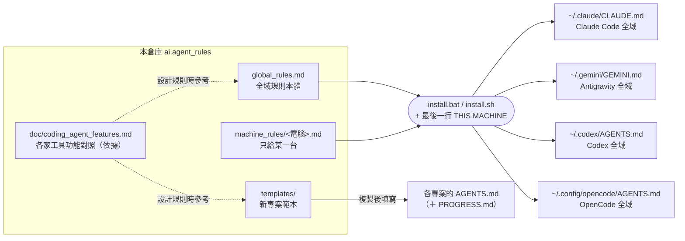
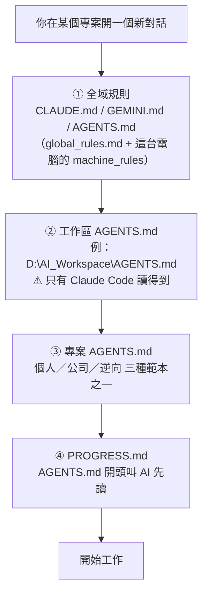
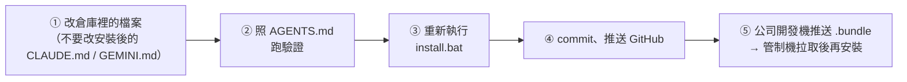

# ai.agent_rules

所有電腦共用的 **coding agent 規則**（目前用 Claude Code、Antigravity、Codex、OpenCode），放在 GitHub，方便每台電腦下載安裝。

> 第一次看：先讀「一、一張圖看懂」和「二、規則要寫在哪裡」就夠了，後面的章節需要時再查。

---

## 一、一張圖看懂

### 1. 規則從哪裡來、裝到哪裡



### 2. 一次對話，AI 會讀到哪些規則



- 越下層越優先：專案 `AGENTS.md` > 工作區 `AGENTS.md` > 全域規則。
- 全部都是**自動載入**，你不用每次貼規則；④ 是 AI 照 ③ 的指示自己去讀。

### 3. 每台電腦裝了什麼

| 電腦 | AI 工具 | ① 全域規則內容 | 專案同步 |
|---|---|---|---|
| 住家開發機（home） | Claude Code、Antigravity、Codex、OpenCode | `global_rules.md` | 只用 GitHub |
| 公司開發機（dev） | Claude Code、Antigravity、Codex、OpenCode | `global_rules.md` | GitHub、`.bundle`（兩邊的中繼） |
| 管制機（controlled） | Antigravity、Codex、OpenCode | `global_rules.md` + `machine_rules/controlled.md`（防毒、安裝、網路限制） | 只用 `.bundle`（連不到 GitHub） |

---

## 二、規則要寫在哪裡

新增一條規則前，照這張表由上往下找第一個符合的：

| 這條規則… | 寫在 | 範例 |
|---|---|---|
| 含公司內部資訊（主機、內網路徑、專案名稱） | 工作區 `AGENTS.md`（不進本倉庫） | 內網磁碟對應 |
| 只適用某一台電腦 | `machine_rules/<電腦代號>.md` | 管制機的防毒限制 |
| 只有公司專案用得到 | `templates/AGENTS_company.md`「公司專案規則」區塊 | 發布、成品防毒相容 |
| 只有逆向分析專案用得到 | `templates/AGENTS_reverse.md`「逆向分析規則」區塊 | 原版備份、寫入長度檢查 |
| 只有一個專案用得到 | 該專案的 `AGENTS.md` | 某工具的業務規則 |
| 是查表、清單、操作步驟 | 本 README | 開發用 CLI 清單 |
| **每次對話、每個專案都需要** | `global_rules.md`（200 行內） | 用繁體中文、`.venv` |

> 原則：全域規則每次對話都整份載入，佔額度又容易干擾，所以**能不放全域就不放**。

---

## 三、檔案總覽

| 檔案 | 給誰看 | 用途 |
|---|---|---|
| `global_rules.md` | AI | 全域規則本體（要改全域規則就改這個檔） |
| `machine_rules/controlled.md` | AI | 只裝到管制機的規則 |
| `templates/AGENTS.md` | AI | 個人專案範本 |
| `templates/AGENTS_company.md` | AI | 公司專案範本（含「公司專案規則」區塊） |
| `templates/AGENTS_reverse.md` | AI | 逆向分析專案範本（含「逆向分析規則」區塊） |
| `templates/PROGRESS.md`、`templates/.gitignore` | AI 與人 | 進度交接檔、Git 排除清單範本 |
| `doc/coding_agent_features.md` | AI 與人 | 各家 coding agent 功能對照表，附查證日期；設計規則的依據 |
| `doc/interactive_question_rules.md` | AI 與人 | 互動式選項卡片提問規則：四家工具規格查證與 `global_rules.md` 提問規範設計說明 |
| `doc/CS2680_agent_practices.md` | AI 與人 | Harvard CS2680 課程重點：寫規則的原則從這裡來 |
| `install.bat`／`install.sh` | 人 | 安裝腳本（Windows／Linux、macOS） |
| `AGENTS.md` | AI | 維護**本倉庫**時的規則（含修改後的驗證方式） |
| `PROGRESS.md` | AI 與人 | 本倉庫的進度與待決定事項 |
| `README.md` | 人 | 本檔 |

---

## 四、安裝

三台有 AI 工具的電腦都要安裝。

1. 取得這個倉庫，放在 `D:\AI_Workspace\ai.agent_rules`（Ubuntu 放在 `~/AI_Workspace/ai.agent_rules`）：
   - 住家開發機、公司開發機：從 GitHub `git clone`。
   - 管制機（連不到 GitHub）：在公司開發機用 GitSync「管理專案 / .venv」→「可加入的資料夾」把本倉庫加進清單並推送到 `.bundle`；再到管制機下載 `.bundle`，用「從 .bundle 建立」取得。
2. Windows：雙擊 `install.bat`，按 `1`（住家開發機）、`2`（公司開發機）或 `3`（管制機）。
   Linux／macOS：執行 `sh install.sh`。
3. 重新啟動 Claude Code／Antigravity。

- 安裝內容 = `global_rules.md` +（有的話）`machine_rules/<電腦代號>.md` + 最後一行 `THIS MACHINE: <電腦代號>`。
- 原本已有的檔案會先備份成 `CLAUDE.md.日期_時間.bak`；內容相同就略過。
- 開發機（home、dev）另外設定 Claude Code **同時讀 `CLAUDE.md` 與 `AGENTS.md`**：`~/.claude/settings.json` 不存在就建立；已存在只檢查，沒有這個設定時顯示 `[WARN]`，請手動在檔案裡加入下面這段（和原有內容合併，注意逗號）：
  ```json
  "pluginConfigs": {
    "cc-plugin-agents-md@builtin": {
      "options": { "instructionFiles": "claude-md-and-agents-md" }
    }
  }
  ```
  也可以在 Claude Code 執行 `/config`，把「Project instructions」改成 `claude-md-and-agents-md`。管制機沒有 Claude Code，不設定。

## 五、修改規則



- 改的是範本（`templates/`）時，還要到各專案把標記之間的區塊**整段替換**（見第六節）。

---

## 六、各層規則細節

### 工作區規則（`D:\AI_Workspace\AGENTS.md`）

- **不是必要的**。只有「好幾個專案共用、但不能放進全域」的內容才需要，例如公司主機名稱、內網磁碟對應、公司專案清單（本倉庫會上 GitHub，這些不能放）。
- ⚠ **只有 Claude Code 讀得到**：Antigravity 往上找規則只到 Git 倉庫根目錄（2026-10-10 實測）。兩個工具都要遵守的規則，放全域或專案。
- 公司工作區 = 公司專案（目標執行環境含管制機或同事電腦）的上一層資料夾，不需要標記檔；`跨專案規範審查.md` 放在這一層，這一層不在 Git，不會跨電腦同步。
- 舊做法（已移除）：以前用 `.workspace_rule` 標記檔讓安裝腳本產生工作區 `AGENTS.md`，2026-10-15 起改成寫進各公司專案。舊的工作區 `AGENTS.md`、`.workspace_rule` 請手動移到資源回收筒。

### 公司專案規則（`templates/AGENTS_company.md`）

- 內網與發布、成品防毒相容、除錯與回報、跨專案規範審查，只有公司專案需要，所以不放全域，寫在每個公司專案 `AGENTS.md` 的「公司專案規則」區塊。
- 區塊前後有標記 `<!-- 公司專案規則：開始 … -->`、`<!-- 公司專案規則：結束 -->`，開頭有「公司規則版本：日期」。
- **修改時**：改範本標記之間的內容並更新版本日期，再到每個公司專案整段替換；專案特有的內容寫在標記外面。
- AI 發現專案沒有這個區塊、或範本版本比較新時，會先照範本做並提醒你合併。

### 逆向分析規則（`templates/AGENTS_reverse.md`）

- 新逆向專案直接複製這個範本當成 `AGENTS.md`，再填上半部的軟體名稱、來源、目的與安裝路徑。
- 每個逆向專案是獨立的 Git 倉庫（Antigravity 讀不到上層），所以每個專案各貼一份；修改時更新「逆向規則版本」日期，再到各專案整段替換。

### 各台電腦的專屬規則（`machine_rules/`）

- 目前只有 `controlled.md`：防毒行為監控的禁止事項、只能裝「僅限目前使用者」的軟體與 `py -3.11` 用法、PowerShell 5.1 語法、被擋的網域。
- 開發機沒有這些限制，可以照常在終端機測試。要給某台加專屬規則，新增 `machine_rules/home.md` 或 `dev.md` 即可，安裝腳本會自動附加。

### 專案的三個檔案

| 檔案 | 什麼時候要有 |
|---|---|
| `AGENTS.md` | 每個專案都要（從 `templates/` 三選一） |
| `README.md` | 每個專案都要（給人看） |
| `PROGRESS.md` | 會跨對話、跨電腦接力的專案；公司專案一律要有 |

---

## 七、各工具自動讀取的規則檔

> 這裡只列日常要知道的重點；完整對照與查證日期見 `doc/coding_agent_features.md`。

| | Claude Code | Antigravity | Codex | OpenCode |
|---|---|---|---|---|
| 全域 | `~/.claude/CLAUDE.md` | `~/.gemini/GEMINI.md` | `~/.codex/AGENTS.md` | `~/.config/opencode/AGENTS.md` |
| 專案 | `AGENTS.md` | `AGENTS.md`（原生支援）、`GEMINI.md` | `AGENTS.md`（原生支援） | `AGENTS.md`（原生支援） |
| 上層資料夾 | 一路讀到磁碟根目錄（所以讀得到工作區） | **只到 Git 倉庫根目錄**（讀不到工作區） | **只到 Git 倉庫根目錄** | **只到 Git 倉庫根目錄** |
| 模組化規則 | `.claude/rules/*.md` | `.agents/rules/*.md` | 子目錄 `AGENTS.md` | `opencode.json` 的 `instructions` |

**三個要記住的坑**

1. **自己的專案不要建立 `CLAUDE.md`**：Antigravity 與 Codex 預設不讀它（OpenCode 雖有相容回退，但已有 `AGENTS.md` 時也不讀 `CLAUDE.md`），規則會只有 Claude Code 看得到。`/init` 會產生 `CLAUDE.md` 或覆寫 `AGENTS.md`，不要用。
   - 安裝腳本已設定 Claude Code「兩者都讀」，所以就算有 `CLAUDE.md`，`AGENTS.md` 也照樣會讀。**沒有這個設定的電腦**，只要路徑上有 `CLAUDE.md`、`.claude/CLAUDE.md` 或 `CLAUDE.local.md`，所有 `AGENTS.md` 都會被跳過、不提示。
   - **fork 別人的專案**常常已經有 `CLAUDE.md`：保留不動（方便之後同步原作者的更新），自己的規則寫在 `AGENTS.md`。
   - 確認方法：Claude Code 開新對話時會自己比對，發現這個資料夾有 `AGENTS.md` 卻沒讀到時，會在開頭告訴你（這是規則提醒，不是強制，不保證每次都做）。想自己確認時，在專案裡執行 `/memory`，清單要同時列出工作區與專案的 `AGENTS.md`；沒有的話檢查 `~/.claude/settings.json`。
2. **模組化資料夾各家不通用**：Claude Code 不讀 `.agents/rules/`，Antigravity、Codex、OpenCode 不讀 `.claude/rules/`。所以**預設只用一份 `AGENTS.md`**；真的長到幾百行、又能依檔案類型切開時，才依各工具格式處理。
3. **網頁版聊天介面（claude.ai、ChatGPT、Gemini）的 Instructions 是另外設定的**，不會讀這些檔案。

---

## 八、coding agent 功能查證

各家 coding agent 的規則檔、Skill、Hook 載入方式常常改版，改了會直接影響 AI 讀不讀得到規則。所以把功能整理在 `doc/coding_agent_features.md`，每列附查證日期，**每個月重新查一次**：

1. 請 AI：「重新查證 `doc/coding_agent_features.md`」。AI 照第五節的官方網址逐頁對照，只改有變動的列，並更新該列與開頭的查證日期。
2. 有變動的列，對照第三節「依賴本表的規則」，修改對應的規則檔。
3. 照第五節「修改規則」重新安裝、提交。

- AI 處理規則檔、Skill、Hook 設定時，發現上次全面查證已超過 1 個月，會提醒你（全域規則第 5 節）。
- 要加入新的 coding agent 時，照該檔第四節的步驟做。

---

## 九、查表區

### 開發用 CLI 清單

全域規則第 1 節指向這張表。你要求檢查時，AI 用 `Get-Command`（Ubuntu 用 `command -v`）逐一確認，經你同意再安裝。新裝了其他開發用 CLI 時補進來。

| 用途 | 指令 | 開發機（Windows／Ubuntu） | 管制機 |
|---|---|---|---|
| AI 寫程式 | `claude`（Claude Code）、`agy`（Antigravity）、`codex`（Codex）、`opencode`（OpenCode） | 都要 | Antigravity、Codex、OpenCode |
| 版控 | `git`、`git-lfs`、`gh` | 都要 | 只用 GitSync 內附 PortableGit；`gh` 不需要（連不到 GitHub） |
| Python | `python`（3.11）、`pip`、`uv` | 都要；Ubuntu 用 `uv` 取得 3.11 | 有 `py -3.11`；`uv` 未確認 |
| Node.js | `node`、`npm`、`npx` | 都要 | 不安裝（官方安裝檔需管理員權限） |
| 雲端部署 | `wrangler`（Cloudflare，`npm i -g`）、`gcloud`／`gsutil`／`bq`（Google Cloud SDK） | 需要時安裝 | 不安裝（連線未確認） |
| 雲端運算 | `colab`（Google Colab，`uv tool install google-colab-cli --python 3.12`） | 需要時安裝 | 不安裝（連線未確認、需 Python 3.12） |

### 專案內資料夾（商業軟體式收納）

全域規則第 5 節指向這張表。比照一般商業軟體「檯面上只留開關與說明書，零件全部收進後台資料夾」的做法：

- **專案根目錄只放**：
  - 啟動器：`.bat`、`.cmd`、`.vbs`、`.exe`、`.sh`（使用者雙擊或執行的唯一入口）
  - 說明書：`README.md`、`使用說明.txt`
  - AI 規則與交接檔：`AGENTS.md`、`PROGRESS.md`
  - 必要的頂層設定：`.gitignore`、`.gitattributes`、`.env`、`.env.example`、`requirements.txt`、`.venv/`
- **禁止散落在根目錄**：`.py`／`.js`／`.gd` 等程式碼、圖片／音效素材、設定檔、測試腳本、log 紀錄與暫存檔，一律分類收進以下子資料夾（有需要才建立，不預先建立空資料夾）：

| 資料夾 | 用途 |
|---|---|
| `src/` | 程式碼（Python `.py`、腳本模組等） |
| `assets/` | 圖片、圖示、音效、字型等靜態素材（AI 生成圖片可放 `assets/generated/`） |
| `config/` | 設定檔（`.json`、`.ini`、`.yaml` 等） |
| `web/` | 要發布到網站的靜態檔案；整個資料夾就是發布白名單，不放開發用的檔案 |
| `static/` | Python 程式（例如 FastAPI）的前端 |
| `scripts/` | 輔助腳本、資料轉換程式 |
| `data/` | 資料；要不要進 Git 依專案在 `.gitignore` 決定 |
| `sample_data/` | 範例資料（一律用虛構值），讓開發機連不到內網時也能測試 |
| `logs/` | 記錄檔，列入 `.gitignore` |
| `tests/`、`docs/` | 測試與文件 |
| `deploy/<部署方式>/` | 只放部署設定（例如 `nas/`、`portable/`）；沒有部署設定檔時不建立 |
| `scratch/` | 開發暫存，列入 `.gitignore`，不部署 |

### AI 生圖規範（Codex `$imagegen` 優先，Gemini 次之）

全域規則第 9 節指向這裡。專案需要生成點陣圖素材（插畫、背景、圖示、概念圖等）時，**嚴格依照以下優先順序**：

1. **第一優先：Codex 內建 `$imagegen`（免 API Key，走 ChatGPT 登入額度）**
   - 在 **Codex** 內：直接呼叫內建 `image_gen`（`$imagegen`）工具。
   - 在 **Antigravity、Claude Code、OpenCode** 內：透過 `codex-imagegen-bridge` 技能，由 PowerShell 呼叫本機 `codex exec` 執行 `$imagegen`：
     1. 先確認 `Get-Command codex` 存在，且 `codex login status` 為 ChatGPT 登入（不可讀取或印出 `%USERPROFILE%\.codex\auth.json`）。
     2. 建立輸出目錄（預設 `assets/generated/`，不覆寫既有檔案），執行：
        ```powershell
        $project = (Get-Location).Path
        $target = Join-Path $project 'assets\generated\image-name.png'
        New-Item -ItemType Directory -Force -Path (Split-Path -Parent $target) | Out-Null
        $prompt = '$imagegen Generate: [描述畫面、風格、構圖與限制]. Save or copy the final PNG to ' + $target + '. Do not use an API key or API fallback.'
        codex exec --skip-git-repo-check --sandbox workspace-write --cd $project $prompt
        ```
     3. 確認目標路徑的圖檔已產生且可讀取。
2. **第二優先：Antigravity 內建 `gemini-3.1-flash-image`（或更高版本，免 API Key，走 Antigravity 登入額度）**
   - 當本機無法使用 Codex CLI bridge，或使用者指定使用 Gemini 生圖時採用。
   - 在 **Antigravity** 內：直接呼叫內建 `invoke_subagent(TypeName="image-generator", ...)` 子代理，再將產出的圖片複製或轉存至 `assets/generated/`。
   - 在 **Claude Code、Codex、OpenCode** 內：透過 `agy-imagegen-bridge` 技能，由 PowerShell 呼叫本機 `agy -p`（2026-10-25 實測確認：讓 `agy -p` 單純呼叫 `image-generator` 子代理，圖片會自動存入 `%USERPROFILE%\.gemini\antigravity-cli\brain\<對話ID>\`，再由外層 PowerShell 取最新圖檔轉存至專案，完全不會卡在 `agy` 內部的終端機權限確認）：
     ```powershell
     $agyExe = if (Get-Command agy -ErrorAction SilentlyContinue) { "agy" } else { "$env:LOCALAPPDATA\agy\bin\agy.exe" }
     $project = (Get-Location).Path
     $target = Join-Path $project 'assets\generated\image-name.png'
     New-Item -ItemType Directory -Force -Path (Split-Path -Parent $target) | Out-Null
     $startTime = Get-Date
     $prompt = 'Invoke the built-in image-generator subagent to generate: [描述畫面、風格、構圖與限制]. Do not run any shell commands; just wait for the subagent to finish and reply with the saved file path.'
     & $agyExe -p $prompt
     $genFile = Get-ChildItem "$env:USERPROFILE\.gemini\antigravity-cli\brain" -Recurse -File -Include *.jpg,*.jpeg,*.png |
         Where-Object { $_.LastWriteTime -ge $startTime } |
         Sort-Object LastWriteTime -Descending |
         Select-Object -First 1
     if (-not $genFile) { throw "Antigravity image-generator did not produce an image file." }
     if ($target.EndsWith('.png') -and $genFile.Extension -match '^\.jpe?g$') {
         Add-Type -AssemblyName System.Drawing
         $img = [System.Drawing.Image]::FromFile($genFile.FullName)
         $img.Save($target, [System.Drawing.Imaging.ImageFormat]::Png)
         $img.Dispose()
     } else {
         Copy-Item -LiteralPath $genFile.FullName -Destination $target -Force
     }
     ```
3. **禁止事項**：
   - 嚴禁使用 Pollinations 等第三方免費生圖網站、帶浮水印或降畫質的替代服務。
   - 未經使用者明確要求，不得切換至需要 `OPENAI_API_KEY` 的付費 CLI／API 模式。
4. **Gemini 頻率限制與防鎖自保機制（重要避坑）**：
   - **原因**：Google 生圖模型（Imagen 3 系列）對短時間內的高頻請求有嚴格的 RPM（Requests Per Minute）限制與防濫用風控，連續快速請求極易觸發 HTTP 429（`RESOURCE_EXHAUSTED`）並導致帳號被暫時凍結 5～15 分鐘。
   - **批次產圖首選 Codex**：短劇分鏡（如一次生成 10 鏡以上首幀）等批次任務，一律優先使用第一優先的 Codex。
   - **Gemini 批次防護守則**：若需透過腳本使用 Gemini 連續產圖，務必在每張圖片之間加入強制冷卻暫停（建議 `time.sleep(18)`，至少 15～20 秒）；若捕獲限流或 429 錯誤，必須指數退避休眠至少 60 秒再重試，嚴禁使用 `for` 迴圈無間隔狂刷。

### 管制機上的 Antigravity 設定建議

| 設定 | 建議值 | 原因 |
|---|---|---|
| Terminal Command Auto Execution | Always Proceed | 防毒限制已寫進管制機專屬規則，AI 從源頭就不會產生會被攔截的指令 |
| Non-Workspace File Access（工作區外的檔案存取） | Always Ask 或 OFF | 避免 AI 讀寫工作區以外的資料夾 |

### Python 升級評估

Python 3.11 的安全更新到 2027-10 結束，2027 上半年要評估升級到 3.12／3.13：

1. 在開發機用測試用的 `.venv` 跑過主要專案（公司專案優先）。
2. 確認管制機能以「僅限目前使用者」安裝新版本（不需要管理員權限）。
3. 兩項都通過後，再改全域規則第 6 節的 Python 版本規定與公司專案規則；升級前不改用 3.11 以外的版本，也不使用無 GIL 版（`3.13t`／`3.14t`）。

---

> 本倉庫目前是 GitHub 私人倉庫，但仍不要寫入公司內部主機名稱、內網路徑、員工編號等資訊：全域規則會安裝到每台電腦，倉庫日後也可能公開。
