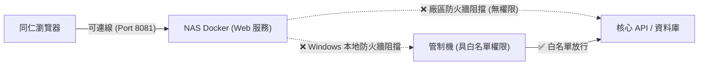
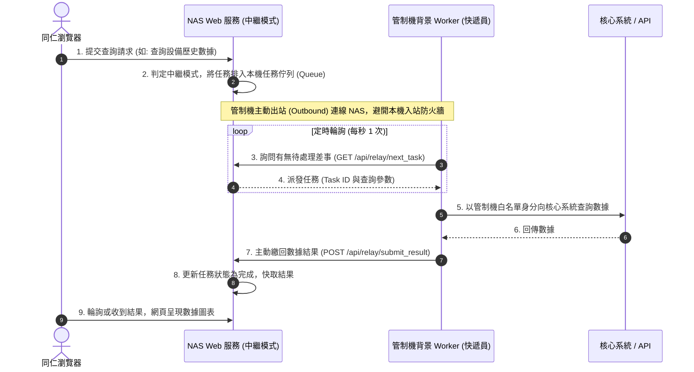

# 反向中繼快遞模式架構指南 (Reverse Relay Worker Pattern)

> 本文件說明如何在公司內網複雜網段隔離與雙向防火牆限制下，透過「反向中繼快遞模式」讓 NAS Docker 上的 Web 系統安全取得內網系統數據。

---

## 一、問題背景與挑戰

在企業或工廠內網環境中，常會遇到以下網路隔離難題：



1. **NAS 位於共用網段**：廠區核心防火牆未放行 NAS 直連核心系統（例如 PI 歷史資料庫、MES 或 ERP Web API）。
2. **管制機具備白名單**：只有特定受控的內部作業電腦（管制機）擁有直連核心系統的存取權限。
3. **入站連線受阻**：管制機開啟了 Windows 本地防火牆，外部（包括 NAS）無法主動連入管制機（Inbound 阻擋）。
4. **申請防火牆耗時**：申請廠區跨網段防火牆放行需冗長簽核，且共用 NAS 往往不符嚴格的安全白名單規範。

---

## 二、解決方案：反向中繼快遞模式

反向中繼快遞模式借鑒了**「郵差向郵局主動領件」**的概念，將主動發起連線的方向反轉：



### 架構核心特點
- **零防火牆申請**：管制機主動發起對 NAS 的 HTTP 請求（Outbound 放行），不需要開放管制機的 Inbound 連接埠，也不需要開通 NAS 到核心系統的防火牆。
- **職責分離**：NAS Docker 專注於 Web 介面服務與多使用者併發存取；管制機專注於背景抓取與代理通訊。
- **任務解耦**：透過任務佇列（Task Queue）排隊，即使用戶多次發送查詢，管制機也能依序平穩處理，防止打垮內部核心伺服器。

---

## 三、系統各端實作要點

### 1. NAS 服務端 (Docker Web App)

- **中繼開關**：於 `.env` 中設定 `RELAY_MODE=true`（直連環境設為 `false`）。
- **任務佇列機制**：
  - 使用 Python 內建的 `queue.Queue` 或全域字典搭配執行緒鎖（`threading.Lock`）保存任務狀態：
    - `tasks[task_id] = {"status": "pending", "params": ..., "result": None, "created_at": ...}`
- **反向中繼專用 API 端點**：
  - `POST /api/query`：前端呼叫，若為中繼模式則產生 `task_id` 排入佇列，回傳 `{"status": "queued", "task_id": "..."}`。
  - `GET /api/query/status?task_id=...`：前端輪詢任務進度。
  - `GET /api/relay/next_task`：管制機 Worker 輪詢領取任務。
  - `POST /api/relay/submit_result`：管制機 Worker 繳回抓取的數據與錯誤狀態。
- **過期清理機制**：排程清理超過 5 分鐘未完成或已完成的過期任務，防止記憶體洩漏。

### 2. 管制機端 (Proxy Relay Worker)

- **背景快遞腳本 (`core/relay_worker.py`)**：
  - 啟動時確認 NAS 端連線（如 `http://<NAS_IP>:<PORT>/`）。
  - 無限迴圈定時向 NAS 請求待辦任務。
  - 領到任務後，呼叫本機直連核心系統的函式庫（例如 `requests.get` 存取核心系統 API）。
  - 將結果（JSON / Binary）POST 回 NAS。
- **錯誤隔離與重試**：
  - 若核心系統斷線或超時，回傳標準錯誤 JSON 給 NAS，前端顯示友善錯誤訊息，避免 Worker 崩潰中斷。
- **雙擊啟動腳本 (防毒相容)**：
  - 專案根目錄提供 `Proxy_Launcher.bat` 與 `Proxy_Launcher.cmd`（啟動 GUI 置頂用 `.cmd` 搭 `start`；管制機禁寫呼叫 `Shell.Application` 的 VBS）：
    ```bat
    @echo off
    cd /d "%~dp0"
    title Proxy Relay Worker
    if exist ".venv\Scripts\python.exe" (
        .venv\Scripts\python.exe -m core.relay_worker
    ) else (
        echo .venv not found. Run setup first.
        pause
    )
    ```

---

## 四、部署與操作流程

1. **部署 Web 服務到 NAS**：
   - 透過 GitSync 發布檔案至 NAS。
   - 於 NAS 專案根目錄複製 `deploy/nas/env.nas.example` 為 `.env`，設定 `RELAY_MODE=true`。
   - 於 Container Manager 啟動容器（例如 Port 8081）。
2. **啟動管制機快遞郵差**：
   - 在管制機專案目錄下雙擊 `Proxy_Launcher.bat`。
   - 主控台顯示：`[Relay Worker] 連線至 http://<NAS_IP>:8081，開始等待任務...`。
   - 維持管制機視窗開啟。
3. **同仁存取**：
   - 同仁直接打開瀏覽器瀏覽：`http://<NAS_IP>:8081/`，即可正常查詢與操作。
